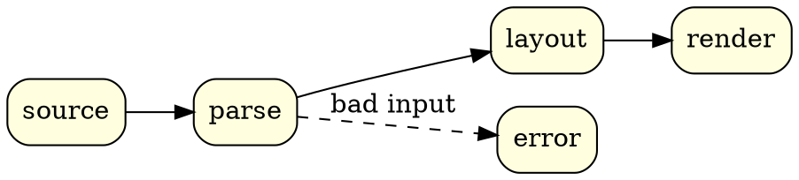
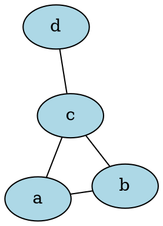

# Graphviz Diagram Preview

## Pipeline



## Neato layout



## Caption, colours and a gradient

```graphviz {alt="Compiler stages with a gradient node" caption="Figure 1: Front end to code generation" align="center"}
digraph {
  node [style=filled]
  subgraph cluster_front { label="Front end"; fillcolor=lightyellow; style=filled; lexer -> parser }
  codegen [fillcolor="red:orange"]
  parser -> codegen [color=darkgreen]
}
```

## Syntax error

```graphviz
digraph {
  x -> ;
}
```
