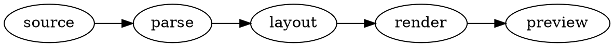
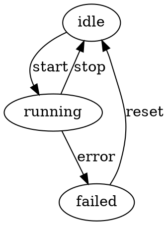
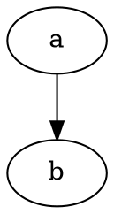
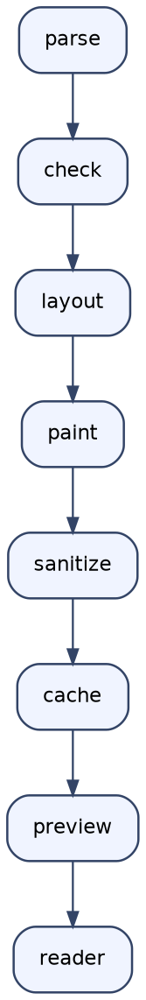
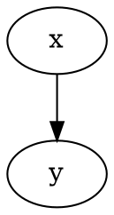

# The view toggle

Every `graphviz` fence below carries a button in its top corner that flips it between the
diagram and the fence's source. This file is the fixture for `npm run test:preview` and the
document for the manual checklist (the source-toggle spec in `onnx-markdown-preview`, section
9.5): open it in a development window and view it in a light, a dark and a high-contrast theme.

## 1. A plain fence



## 2. Captioned, centred: the button stays at the column edge



## 3. Right-aligned with alt: the card sits under the button



## 4. Error card: the source view shows the body alone

```graphviz
digraph broken {
  a -> ;
}
```

## 5. Long lines and a tall body: horizontal scroll, height jump



## 6. Two identical bodies: flip the second one only, then edit this heading




## 7. An ordinary fence: no toggle, VS Code's own copy button on hover

```json
{ "compare": "hover me: the copy button is top-right, on hover only" }
```

## 8. Right-to-left container: the button moves to the left

<div dir="rtl">


</div>

## 9. Quirks

The Graphviz preview has no loading placeholder, notes or slot cache; a graph that takes longer
than the layout limit shows a timeout card, which the toggle treats like any error card.
